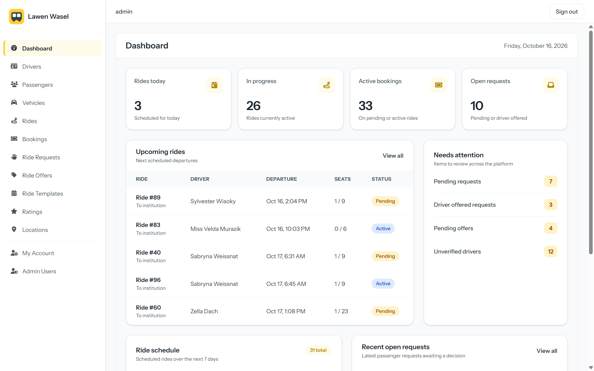
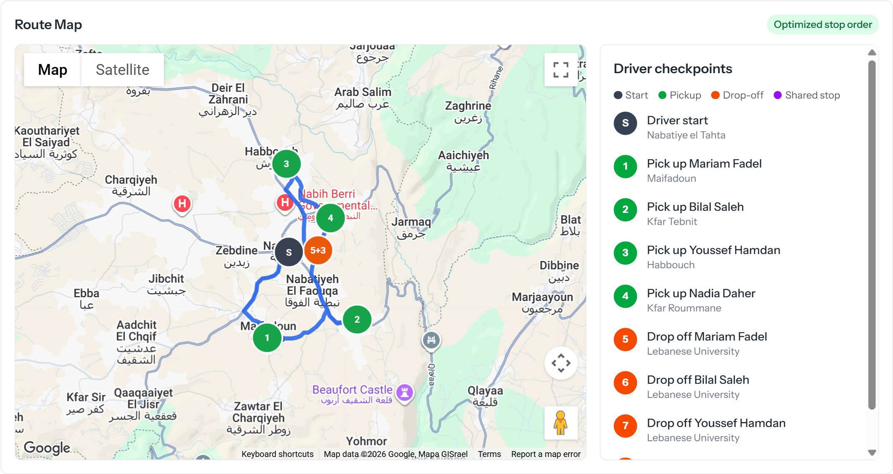

# Lawen Wasel - Student Ride Sharing Platform


A Laravel-based ride-sharing platform for students traveling to and from their institutions. This repository contains the API for passenger and driver clients and a Livewire admin panel; a mobile client is not included. Passengers can search, request, and book rides, drivers can manage vehicles and offers, and admins can monitor the operation.

## Screenshots

Screenshots show generated demo data.





More views: [admin login](docs/screenshots/admin_login.png), [ride details and bookings](docs/screenshots/ride_detail.png), [ride requests](docs/screenshots/ride_requests.png), [driver profile](docs/screenshots/driver_profile.png), and [passenger profile](docs/screenshots/passenger_profile.png).

## 🌟 Key Features

### For Passengers

- **Smart Ride Search**: Search available rides by pickup city, arrival/return time windows, seat count, and institution
- **Ride Requests**: Submit ride requests with a pickup location and institution destination
- **Negotiation System**: Receive and accept custom driver offers with suggested pickup points and pricing
- **Booking Management**: Track active bookings, view ride details, and cancel reservations
- **Multi-Stop Support**: Rides pool multiple passengers per vehicle with per-passenger pickup/dropoff nodes

### For Drivers

- **Vehicle Management**: Register and manage multiple vehicles with image galleries
- **Ride Templates**: Define recurring weekly schedules; active templates keep the next seven days of rides available when Laravel's scheduler is running
- **Dynamic Ride Creation**: Set up one-time rides with a specific vehicle, time, and stop list
- **Ride Request Handling**: Review incoming passenger requests and accept/reject them
- **Custom Offers**: Send personalized ride offers with suggested pickup locations and pricing
- **Route Optimization**: Multi-stop route ordering via the OpenRouteService optimization API
- **Driver Verification**: Admin-gated verification before a driver can publish rides or templates

### Admin Panel

- **Operations Dashboard**: Today's rides, active bookings, open requests, items needing attention, upcoming rides, and a seven-day schedule
- **Passenger and Driver Profiles**: Inspect passenger and driver records
- **Driver Verification**: Toggle driver verification status
- **Admin Accounts**: Update your own name, email, and password; super admins can create accounts, change admin access, and disable or re-enable accounts
- **Location Management**: CRUD operations for cities, stations, and institutions
- **Ride Monitoring**: View ride details, numbered driver checkpoints, road routes, and booking information
- **Vehicle Oversight**: Review registered vehicles and their images
- **Booking Tracking**: Monitor active and historical bookings

### Technical Features

- **Multi-Step Registration**: Email-verification-code flow before account creation
- **Role-Based Access Control**: Driver and passenger API middleware, a distinct admin auth guard, and super admin restrictions for account management
- **API Authentication**: Laravel Sanctum for token-based mobile API auth
- **Geolocation Support**: GPS coordinates on users, locations, and ride pickup/dropoff nodes
- **Google Maps Integration**: Reverse geocoding, admin-side route visualization, and a road route fallback
- **Route Optimization**: OpenRouteService integration for multi-stop route planning
- **Conflict Prevention**: Detects duplicate/overlapping ride requests per passenger
- **Transaction Safety**: Database transactions and row locking around booking/seat updates
- **Email Notifications**: Verification codes and password-reset codes via Mail

## 🛠️ Tech Stack

- **Framework**: Laravel 12.x
- **PHP Version**: 8.2+
- **Authentication**: Laravel Sanctum (API), session-based guard (Admin)
- **Frontend**: Livewire 3.6 + Tailwind CSS (Admin Panel)
- **Database**: SQLite by default; local demo records are generated by seeders
- **External APIs**:
   - Google Maps JavaScript, Routes, and Geocoding APIs
   - OpenRouteService Optimization API

## 📋 Prerequisites

- PHP 8.2 or higher
- Composer
- SQLite (tested default); MySQL/PostgreSQL migrations have not been verified
- Node.js and NPM (for admin panel frontend assets)
- _(Optional)_ Google Maps API key for the admin ride map and reverse geocoding
- _(Optional)_ OpenRouteService API key for optimized stop order and route geometry

## 🚀 Installation

### 1. Clone the Repository

```bash
git clone https://github.com/Mhmdkh77/lawen-wasel.git
cd lawen-wasel/backend
```

### 2. Install Dependencies

```bash
composer install
npm install
```

Run the remaining commands from the `backend` directory. PHP needs the SQLite extensions (`pdo_sqlite` and `sqlite3`) for the default database.

### 3. Environment Configuration

```bash
cp .env.example .env
php artisan config:clear
php artisan key:generate
```

On PowerShell, use `Copy-Item .env.example .env` instead of `cp`. The `.env` file stays local and should not be committed.

### 4. Configure the Database

Database files are not committed. The default `.env.example` uses SQLite. Create an empty local file from the `backend` directory:

```bash
# macOS/Linux
touch database/database.sqlite
```

```powershell
# PowerShell
New-Item database/database.sqlite -ItemType File
```

Then run the migrations and local seed in steps 6 and 7. Your SQLite file is ignored by Git and remains on your computer.

To use a fresh MySQL database instead, create the database and edit `.env`:

```env
DB_CONNECTION=mysql
DB_HOST=127.0.0.1
DB_PORT=3306
DB_DATABASE=my_db
DB_USERNAME=your_username
DB_PASSWORD=your_password
```

### 5. Configure External Services

Add only the services you need to `.env` (none of these keys are pre-filled in `.env.example`):

```env
# Google Maps (reverse geocoding + admin route map)
GOOGLE_MAPS_API_KEY=your_google_maps_key

# OpenRouteService / HeiGIT VROOM (multi-stop route optimization)
ORS_API_KEY=your_ors_api_key
```

The app starts without map keys. For the admin map, add a Google Maps key and enable Maps JavaScript API. Enable Routes API if you want Google to draw a road line when OpenRouteService does not provide one. Geocoding API is used to turn coordinates into place names. The current code uses one Google key for both the browser map and server-side geocoding. This works for a local demo, but a key restricted to your website may block the server request. Before a public deployment, configure separate, appropriately restricted keys for the browser and server.

The ride page displays numbered checkpoints in driver order: `S` for the start, green for pickup, orange for drop-off, and purple when different checkpoint types share a location. OpenRouteService can optimize the stop order and return road geometry. If it does not return geometry, Google's Routes Library tries to draw a road route through the displayed checkpoints. If road directions are unavailable from both services, a dashed orange line shows checkpoint order only; it is not a drivable route. Without OpenRouteService, the checkpoints follow their saved order. To enable optimization, configure an OpenRouteService key with VROOM access and allow the PHP server to reach `https://api.heigit.org/vroom/v0`.

Restart the server after changing `.env` values; if configuration is cached, run `php artisan config:clear` first.

The default `MAIL_MAILER=log` writes registration and password-reset codes to `storage/logs/laravel.log`. Configure SMTP in `.env` if you need real email delivery.

### 6. Apply Database Migrations

```bash
php artisan migrate
```

Run this for a new database or to apply new migrations to an existing installation without clearing its data. To deliberately rebuild a disposable local database from scratch, `php artisan migrate:fresh --seed` deletes all tables and data before recreating and seeding them.

### 7. Seed Local Demo Data (Optional)

```bash
php artisan db:seed
```

Run this only once after migrating a fresh local database. Re-running the full seeder can duplicate the demo admin and fail. It creates a demo admin (`admin@admin.com` / `admin`), passenger (`passenger@user.com` / `pass`), and driver (`driver@user.com` / `pass`), plus sample locations, vehicles, and rides. See `database/seeders/DatabaseSeeder.php`. Change the demo credentials before exposing an instance publicly.

The seed also adds connected examples around Nabatieh so the admin pages show more than empty tables: pooled and round-trip bookings, rides in different statuses, competing driver offers, reviewed rides, vehicle photos, and recurring templates. These are examples of seed data, not the full feature list. Look for `SHOW-` vehicle plates and `Showcase |` template groups in the admin panel. Showcase users have `showcase.<name>@example.test` emails and the demo password `pass`.

To add only these connected scenarios to an existing database, without re-running the random demo seed, use:

```bash
php artisan db:seed --class=ShowcaseSeeder
```

The showcase seeder can be run again without duplicating its records.

### 8. Link Public Storage

```bash
php artisan storage:link
```

Required for public vehicle and profile images. All driver license images use private storage and are viewed through authenticated routes.

### 9. Build Frontend Assets

```bash
npm run build
# or, for development with hot reload:
npm run dev
```

### 10. Start the Development Server

```bash
php artisan serve
```

On Windows, use `./serve-fast.ps1` from `backend` for faster local page loads. It runs the same development server with PHP OPcache enabled; PHP must include `php_opcache.dll`. Route optimization is cached after the first successful request, so reopening a ride does not wait for the routing API again.

Access the admin panel at `http://localhost:8000/admin/login`. The app has no page at `/`.

#### Admin accounts

Every active admin can open **My Account** (`/admin/account`) to update their name, email, and password. Changing the email or password requires the current password; changing the password signs the admin out.

Only a super admin can open **Admin Users** (`/admin/admins`) to create an admin with an initial password, grant or remove super admin access, and disable or re-enable an account. Disabled admins cannot sign in or continue an existing session. A super admin cannot disable or demote their own account. There is no email invitation flow for newly created admins.

The seeded `admin@admin.com` account is a super admin; change its demo password before using the app beyond local development. When the admin-access migration runs on an existing database, it grants super admin access to the oldest admin account.

### Public deployment

The repository is configured for local development and does not currently include a maintained deployment setup. A public instance needs its own persistent database, private environment variables, non-demo admin credentials, and a plan for uploaded files. The local SQLite database and uploaded data should not be copied into a public deployment.

### 11. (Optional) Enable Recurring Ride Generation

Creating a Ride Template makes matching rides available for the next seven calendar days, including today when its departure time has not passed. A daily command at 00:05 in the app timezone adds the next day to that rolling window, so passengers can book recurring rides several days ahead:

```bash
php artisan schedule:list
```

This confirms Laravel has registered the 00:05 job. To run it automatically on a local machine, keep `php artisan schedule:work` running in a second terminal. In production, configure cron to call Laravel's scheduler every minute:

```bash
# crontab, for production (run from the backend directory)
* * * * * cd /path/to/lawen-wasel/backend && php artisan schedule:run >> /dev/null 2>&1
```

To check generation without changing your local database, run the focused test below. It creates a temporary test database and checks the seven-day window, repeated runs, and the next day's extension:

```bash
php artisan test --filter="recurring templates keep seven days of rides available without duplicates"
```

You can also run `php artisan app:generate-daily-rides` manually, but that writes rides to the currently configured database.

## 📱 API Documentation

The platform exposes a RESTful JSON API for the mobile clients.

### Quick Start

**Base URL**: `http://localhost:8000/api`

**Authentication**: protected endpoints require a Sanctum bearer token

```http
Authorization: Bearer {your_token}
```

### Endpoint Categories

- 🔐 **Authentication** — register (multi-step), login, password reset
- 👤 **User** — profile, password change, logout
- 🚗 **Passenger** — search rides, ride requests, ride offers, bookings
- 🚙 **Driver** — vehicles, ride templates, ride requests/offers, rides
- 📍 **Locations** — cities, stations, institutions

### Example Request

```bash
curl -X POST http://localhost:8000/api/login \
  -H "Content-Type: application/json" \
  -d '{
    "login": "passenger@user.com",
    "password": "pass"
  }'
```

**For an endpoint overview, see [docs/API-docs.md](docs/API-docs.md).**

## 🗄️ Database Schema

The migrations in `backend/database/migrations` are the source of truth for the schema. No database file is committed. The main tables are:

### Core Tables

- **users**: User accounts (passengers and drivers)
- **admins**: Admin panel users, active status, and super admin access
- **passengers** / **drivers**: Role-specific profile data
- **vehicles** / **vehicle_images**: Driver vehicles and their photos
- **locations**: Cities, stations, and institutions with GPS coordinates
- **rides** / **ride_groups**: Individual ride instances, grouped by route + driver
- **ride_templates** / **ride_template_groups**: Recurring schedules drivers define once
- **ride_requests** / **ride_offers**: The passenger-request / driver-offer negotiation flow
- **bookings** / **booking_groups**: Confirmed seat reservations
- **nodes**: Per-booking pickup/dropoff points used for route optimization

## 🏗️ Architecture Highlights

### Design Patterns

- **Service Layer**: `LocationService` (geocoding, route optimization) and `BookingStopService` (pickup/drop-off direction)
- **Middleware Authentication**: `driver`, `driver-verified`, and `passenger` API middleware; an `admin` auth guard with `admin-active` and `super-admin` middleware for the panel
- **Ride Data Model**: Ride groups connect a driver and location group to one or more rides. Bookings link passengers to rides, with nodes recording their pickup and drop-off points.
- **Database Transactions**: Booking/ride creation wraps multi-table writes in transactions with row locking on seat counts

### Key Algorithms

- **Ride Matching**: Resolve pickup coordinates to a supported city, then filter pending rides by pickup area, institution, seats, and a ±1 hour time window
- **Route Optimization**: Shipment-based routing via the OpenRouteService optimization API
- **Conflict Detection**: Prevents a passenger from double-booking overlapping rides
- **Seat Tracking**: `available_seats`/`booked_seats` kept in sync via transactional increments/decrements

### Security Features

- Password hashing (bcrypt)
- Sanctum API token authentication
- CSRF protection (admin panel)
- Current-password checks for admin email and password changes, and blocked access for disabled admin accounts
- Eloquent ORM parameter binding (SQL injection prevention)
- Rate-limited auth/registration endpoints
- Email verification before account activation

## 📂 Project Structure

The repository root contains the public documentation; the Laravel application lives in `backend/`. This shows the main directories and entry points:

```
lawen-wasel/
├── README.md                 # Project overview and setup
├── docs/
│   ├── API-docs.md           # API reference
│   └── screenshots/          # Admin panel screenshots
└── backend/
    ├── app/
    │   ├── Console/Commands/ # Scheduled ride generation
    │   ├── Http/             # Admin/API controllers and middleware
    │   ├── Livewire/         # Admin tables
    │   ├── Mail/             # Verification and reset emails
    │   ├── Models/           # Eloquent models
    │   ├── Policies/         # Authorization rules
    │   └── Services/         # Booking, location, and ride logic
    ├── config/               # Laravel configuration
    ├── database/
    │   ├── factories/
    │   ├── migrations/
    │   └── seeders/          # Demo data, private license fixtures, and location CSV
    ├── public/               # Web entry point
    ├── resources/            # CSS, JavaScript, SVG logo, and Blade views
    ├── routes/               # api.php, web.php, console.php
    ├── storage/app/public/   # Public profile and vehicle illustrations; uploads are ignored
    ├── tests/                # Feature tests
    ├── artisan
    ├── composer.json
    ├── package.json
    └── serve-fast.ps1        # Optional Windows development server
```

## 🧪 Running Tests

```bash
php artisan test
```

The feature tests cover admin access and pagination, showcase seed data, route checkpoints, ride search, driver ride-request access, recurring rides, and private driver license access. Broader API coverage is still needed.

## Future work / TODO

Current limitations and planned improvements:

- Make booking cancellation safe to repeat and safe under concurrency. Currently `PassengerRideController::cancelBooking()` does not require an active booking or lock the ride before returning seats.
- Complete request/offer state transitions inside transactions, including parent-request acceptance, competing-offer expiry, and locked pending-state checks. Current offer acceptance updates the selected offer but leaves its parent request and competing offers unchanged.
- Check driver ownership of vehicles used in recurring templates. Current template validation checks vehicle existence only. Also recheck capacity and seat counters when changing a ride's vehicle.
- Replace the fixed direct-request booking price of 100 with an explicit pricing policy; document currency, per-leg pricing, cancellation rules, and offer semantics. Those product rules are not yet settled.
- Refine recurring generation when templates are edited or disabled: existing future rides are not automatically rescheduled or withdrawn. The app currently uses UTC; select an explicit operating timezone before deployment.
- Refine pickup geography beyond the nearest supported city center within 10 km. Current request-conflict checks compare scheduled minutes and daily rules rather than ride-duration overlap.
- Harden password-reset verification/session binding, code expiry/resend behavior, registration transactions, admin-login throttling, and API token lifecycle.
- Verify the new relationship constraints on MySQL/PostgreSQL before using those database engines. SQLite migration, rollback, existing-data integrity, and application tests pass locally.
- Add meaningful local tests for cancellation, pricing, template ownership/activation, multiple daily schedules, search, password reset and concurrent seat accounting; record results before claiming readiness.
